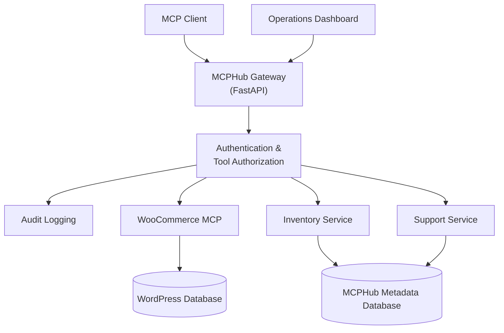

<div align="center">

# MCPHub

### A secure, Kubernetes-native MCP gateway for WooCommerce, Inventory, and Support

One endpoint. Many tool providers. Centralized authentication, authorization, and audit logging.


[Live Demo](#live-demo) · [Architecture](#architecture) · [Connect a Client](#connecting-an-mcp-client) · [Local Development](#local-development) · [Documentation](#documentation)

</div>

---

## Why MCPHub?

MCP clients need a consistent, controlled way to use tools from different services. Wiring every client directly to every upstream creates duplicated credentials, inconsistent access rules, and no single place to answer *"who called what, and when?"*

MCPHub sits in front of your upstream services and gives clients **one MCP endpoint** while the gateway handles:

- **Authentication**: identity-specific API keys
- **Authorization**: role- and tool-level permissions, enforced on every call
- **Routing**: requests are forwarded to the correct upstream service
- **Auditing**: caller-attributed records of tool-call activity

Upstream services stay behind the gateway instead of being exposed to clients.

## Live Demo

| Component | Link |
|---|---|
| Operations Dashboard | [sandeep-mcp-demo.duckdns.org/dashboard](https://sandeep-mcp-demo.duckdns.org/dashboard) |
| WooCommerce Storefront | [sandeep-mcp-demo.duckdns.org](https://sandeep-mcp-demo.duckdns.org/shop/) |
| MCP Endpoint (Streamable HTTP) | `https://sandeep-mcp-demo.duckdns.org/mcp` |
| WordPress / WooCommerce Admin | [sandeep-mcp-demo.duckdns.org/wp-admin](https://sandeep-mcp-demo.duckdns.org/wp-admin/) |

> **Note:** The demo runs on Kubernetes with HTTPS and uses **synthetic data**. It is intended for assessment and demonstration, not production workloads. Availability and certificate status may change.

> **Security:** Never publish API keys, passwords, session cookies, database credentials, or private configuration in screenshots, recordings, source files, or issue reports.

## Table of Contents

- [Why MCPHub?](#why-mcphub)
- [Live Demo](#live-demo)
- [Features](#features)
- [Architecture](#architecture)
- [Connecting an MCP Client](#connecting-an-mcp-client)
- [Local Development](#local-development)
- [Testing and Validation](#testing-and-validation)
- [Security Considerations](#security-considerations)
- [Documentation](#documentation)

## Features

| | Capability | Details |
|---|---|---|
| 🔌 | **Unified MCP access** | Tools from WooCommerce, Inventory, and Support are exposed through a single MCP endpoint. |
| 🔑 | **API-key authentication** | Each caller is identified by its own key, sent via the `X-API-Key` header. |
| 🛡️ | **Tool-level authorization** | Roles and explicit tool grants decide what an identity may invoke. Authentication alone never implies permission. |
| 📜 | **Audit logging** | Tool-call metadata records caller attribution and execution outcome, without storing secrets. |
| 📊 | **Operations dashboard** | A React UI and assistant for interacting with the gateway. Assistant tool calls go through the same auth and authorization controls. |
| ☸️ | **Kubernetes-ready** | Kubernetes manifests and Helm charts, with persistent storage for stateful services. |

## Architecture



### Request flow

1. An MCP client or the dashboard sends a request to the gateway.
2. The gateway **authenticates** the caller.
3. **Authorization** checks whether that identity may invoke the requested tool.
4. The gateway **routes** the call to the matching upstream service.
5. The response is returned to the caller and **audit metadata** is recorded.

> This diagram shows the intended logical flow. See [System Design](docs/system-design.md) for exact request paths, storage boundaries, and failure behavior.

### Components

| Component | Responsibility |
|---|---|
| **Gateway** | Exposes REST and MCP endpoints, authenticates requests, checks permissions, routes tool calls. |
| **Dashboard** | Operations interface and assistant experience. |
| **WooCommerce integration** | Provides supported WooCommerce tools via its MCP integration. |
| **Inventory service** | Provides inventory-related tools. |
| **Support service** | Provides support-ticket tools. |
| **Persistence** | Stores WordPress data and MCPHub metadata in their configured databases. |
| **Kubernetes & Helm** | Package and deploy the application and its supporting services. |

## Connecting an MCP Client

MCPHub speaks **MCP over Streamable HTTP**. Authenticate by sending your assigned key in the `X-API-Key` header.

| Environment | Endpoint |
|---|---|
| Hosted demo | `https://sandeep-mcp-demo.duckdns.org/mcp` |
| Local | `http://127.0.0.1:8010/mcp` |

### Example: Claude Code

```bash
claude mcp add --transport http mcphub \
  https://sandeep-mcp-demo.duckdns.org/mcp \
  --header "X-API-Key: YOUR_ASSIGNED_API_KEY"
```

### Example: generic client configuration

Any MCP client that supports Streamable HTTP and custom headers can use a configuration like this (exact field names vary by client):

```json
{
  "mcpServers": {
    "mcphub": {
      "type": "http",
      "url": "https://sandeep-mcp-demo.duckdns.org/mcp",
      "headers": {
        "X-API-Key": "YOUR_ASSIGNED_API_KEY"
      }
    }
  }
}
```

### Quick connectivity check

```bash
curl -s https://sandeep-mcp-demo.duckdns.org/mcp \
  -H "Content-Type: application/json" \
  -H "Accept: application/json, text/event-stream" \
  -H "X-API-Key: YOUR_ASSIGNED_API_KEY" \
  -d '{"jsonrpc":"2.0","id":1,"method":"initialize","params":{"protocolVersion":"2025-03-26","capabilities":{},"clientInfo":{"name":"curl-check","version":"0.0.1"}}}'
```

> **Important**
> - Replace `YOUR_ASSIGNED_API_KEY` locally. Never commit real keys or paste them into public docs.
> - Always connect to the gateway, never directly to internal upstream services.
> - The tools you see depend on the configured upstreams and **your identity's permissions**.

## Local Development

Run all commands from the repository root in **PowerShell**.

### 1. Start port forwards

First bring up the local Kubernetes environment and required services per the repository's deployment instructions, then run:

```powershell
.\scripts\start-local-ports.ps1
```

| Component | Local URL |
|---|---|
| Dashboard | http://127.0.0.1:5174 |
| Storefront | http://127.0.0.1:8081 |
| Gateway REST API | http://127.0.0.1:8010 |
| Gateway MCP endpoint | http://127.0.0.1:8010/mcp |

These endpoints depend on your local cluster, Services, and port-forwarding being available.

### 2. Open the dashboard

Visit <http://127.0.0.1:5174> once the dashboard and backend services are running.

### 3. Stop the port forwards

```powershell
.\scripts\stop-local-ports.ps1
```

**Related guides:** [Local Ingress](docs/local-ingress.md) for host-based routing and verification · [WooCommerce MCP](docs/woocommerce-mcp.md) for integration setup and read-only checks.

## Testing and Validation

**Python test suite**

```powershell
.\.venv\Scripts\python.exe -m pytest -q
```

**Dashboard checks**

```powershell
Push-Location .\apps\dashboard
npm test
npm run lint
npm run build
Pop-Location
```

**Helm**

Use the environment-specific values and commands in [Helm Upgrades and Rollback](docs/helm-upgrades-rollback.md). Review rendered resources before installing or upgrading, and do not assume chart defaults suit an existing deployment.

> Run the checks in your own environment and review the output before reporting results. Passing tests do not by themselves prove the deployed system is secure, available, or production-ready.

## Security Considerations

- Keep credentials and private keys out of source control.
- Use narrowly scoped API keys, and revoke keys that are no longer needed.
- Enforce authorization at the gateway for **every** tool invocation.
- Keep upstream Services and credentials internal wherever the architecture allows.
- Avoid logging secrets, authentication headers, or unnecessary sensitive data. Audit records must not contain secrets.
- Use synthetic records for demos and test transactions.
- Review persistent storage, backups, recovery, and access controls before any production deployment.
- Treat the hosted demo as an assessment environment, not a production service.

For details and known limitations, see the [Threat Model](docs/threat-model.md) and [Security and Operations](docs/security-operations.md).

## Documentation

| Document | Description |
|---|---|
| [System Design](docs/system-design.md) | Architecture, request flow, and service boundaries. |
| [Threat Model](docs/threat-model.md) | Trust boundaries, threats, mitigations, and residual risks. |
| [Security and Operations](docs/security-operations.md) | Secret configuration, identity lifecycle, validation, troubleshooting. |
| [Helm Upgrades and Rollback](docs/helm-upgrades-rollback.md) | Release upgrades, health checks, and rollback procedures. |
| [Local Ingress](docs/local-ingress.md) | Local host-based routing and verification. |
| [WooCommerce MCP](docs/woocommerce-mcp.md) | WooCommerce integration and MCP checks. |
| [Chat Assistant](docs/chat-agent.md) | Assistant configuration and tool-call flow. |
| [OAuth](docs/oauth.md) | OAuth implementation and known limitations. |
| [VPS / k3s Deployment](docs/vps-k3s-deployment.md) | Fresh-cluster deployment, storage, TLS, backup, and recovery. |
| [Demo Recording Checklist](docs/demo-recording-script.md) | Demo sequence and recording precautions. |
| [Bonus Features](docs/bonus-features.md) | Additional features and documented limitations. |

---

<div align="center">

**MCPHub**: one gateway for multiple MCP tool providers, with centralized access control and operational visibility.

</div>
