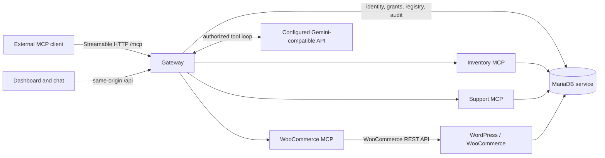

<div align="center">

# MCPHub

### One authenticated Streamable HTTP endpoint for multiple MCP services

WooCommerce · Inventory · Support


[Azure demo](#azure-demo) · [Architecture](#architecture) · [Connect a client](#connect-an-mcp-client) · [Local development](#local-development) · [Validation](#validation)

</div>

MCPHub is a Kubernetes-hosted MCP gateway. Clients connect to the gateway rather than directly to upstream servers. The gateway authenticates each request, filters tool discovery by explicit permissions, checks permission again when a tool is invoked, routes the call, and records sanitized audit metadata.

## Azure demo

The assessment demo runs on an Azure Ubuntu VM using k3s, Helm, and Traefik. Its public hostname is `sandeep-mcp-demo.duckdns.org`.

| Service | HTTPS URL | Ingress destination |
|---|---|---|
| Dashboard | <https://sandeep-mcp-demo.duckdns.org/dashboard> | `mcphub-dashboard:8080` at `/dashboard` |
| Storefront | <https://sandeep-mcp-demo.duckdns.org/> | `mcphub-wordpress:80` at `/` |
| MCP endpoint | <https://sandeep-mcp-demo.duckdns.org/mcp> | `mcphub-gateway:8000` at `/mcp` |
| WordPress / WooCommerce admin | <https://sandeep-mcp-demo.duckdns.org/wp-admin/> | WordPress storefront service |

Traefik routes these paths in namespace `mcphub` with IngressClass `traefik`. The routes reference TLS Secret `mcphub-public-tls`; the repository's Azure certificate manifest uses cert-manager and the `letsencrypt-production` ClusterIssuer. HTTP redirects to HTTPS. Do not send API keys over HTTP.

**Deployment snapshot:** the repository's latest recorded Azure verification is dated **2026-10-24**. At that check, gateway, dashboard, Inventory MCP, Support MCP, and WooCommerce MCP each had two Ready replicas; WordPress and MariaDB each had one Ready pod; both store PVCs were Bound; HTTPS and the certificate were valid. This is dated evidence, not a live status guarantee. Check the deployment before a demo using [the Helm operations guide](docs/helm-upgrades-rollback.md).

The store Helm release is named `mcphub-store` in namespace `default`, while its Kubernetes workloads are in `mcphub`. The other application releases are in `mcphub`. The demo uses persistent MariaDB and WordPress volumes and synthetic assessment data; it is a single-node demonstration environment, not a production availability or backup guarantee.

## Capabilities

| Upstream | Read tools | Write tools |
|---|---|---|
| Inventory | `list_inventory` | `update_stock` |
| Support | `list_tickets`, `get_ticket` | `create_ticket`, `update_ticket_status` |
| WooCommerce | `list_products`, `list_orders`, `get_order` | `create_product`, `update_order_status` |

The gateway exposes discovered tools with upstream-qualified names, for example `inventory__list_inventory`. API-key authentication uses `X-API-Key`; OAuth is an optional MCP authentication flow when issuer and resource configuration is present. REST and admin endpoints require an API key. Admin identities have administrative access. Operators and viewers need explicit identity- or team-level tool grants; viewers are also limited to the built-in read-only tool set. A role by itself does not grant access.

The dashboard includes upstream health, tool exploration, user/key/permission administration, audit and aggregate tool-call metrics, and a Gemini-backed chat assistant. The assistant receives only the signed-in identity's authorized tool catalog, and tool calls execute through the gateway. The demo gateway values configure Google's OpenAI-compatible API with model `gemini-3.5-flash-lite`; its key is referenced from Kubernetes Secret `mcphub-llm-secret`, key `api-key`. The provider key and upstream credentials remain server-side.

## Architecture



The MariaDB service hosts separate `mcphub` metadata and `wordpress` store databases. The metadata database contains identities, teams, SHA-256 API-key hashes, explicit grants, upstream registrations, audit records, and Inventory/Support data. WordPress uses the store database and its persistent volume. Internal MCP and database Services are not intended for direct client access.

The gateway applies bounded upstream discovery and tool-call deadlines. Discovery and execution failures are isolated per upstream; error responses use sanitized categories. A disabled upstream is excluded from discovery and calls. MariaDB DDL can auto-commit, so migration failures require inspection before retry; see [VPS deployment and recovery](docs/vps-k3s-deployment.md).

## Connect an MCP client

Use the HTTPS endpoint and a key issued for the intended identity. The key must have grants for the tools the client needs. Keep the key in the client's credential store or environment configuration; do not commit it or put it in shell history.

### Claude Code

For clients supporting environment expansion, put a reference—not the key—in `.mcp.json`:

```json
{
  "mcpServers": {
    "mcphub": {
      "type": "http",
      "url": "https://sandeep-mcp-demo.duckdns.org/mcp",
      "headers": { "X-API-Key": "${MCPHUB_API_KEY}" }
    }
  }
}
```

Set `MCPHUB_API_KEY` through a protected local credential mechanism before starting Claude Code, then check the connection with `/mcp`. See the [Claude Code MCP configuration reference](https://code.claude.com/docs/en/mcp).

Other MCP clients should be configured for **Streamable HTTP**, the `/mcp` URL, and the `X-API-Key` header. The exact configuration fields depend on the client. Do not connect an external client directly to an upstream MCP Service.

### Safe initialization check (Bash or Git Bash)

This prompts for the key without echo and passes it to curl through standard input. It sends an MCP `initialize` request and does not invoke a tool.

```bash
(
  read -r -s -p "MCPHub API key: " MCPHUB_API_KEY
  printf '\n'
  curl --silent --show-error --include --config - <<EOF
url = "https://sandeep-mcp-demo.duckdns.org/mcp"
request = "POST"
header = "Content-Type: application/json"
header = "Accept: application/json, text/event-stream"
header = "X-API-Key: ${MCPHUB_API_KEY}"
data = "{\"jsonrpc\":\"2.0\",\"id\":1,\"method\":\"initialize\",\"params\":{\"protocolVersion\":\"2025-03-26\",\"capabilities\":{},\"clientInfo\":{\"name\":\"curl-check\",\"version\":\"0.0.1\"}}}"
EOF
)
```

## Local development

The local port-forward script connects to an **already-running** Kind deployment; it does not create a cluster or install charts. Prerequisites: PowerShell, `kubectl`, and a current context named `kind-kind`, with the dashboard, gateway, WordPress, Traefik, MariaDB, and enabled upstreams already deployed.

From the repository root:

```powershell
.\scripts\start-local-ports.ps1
```

| Component | Local URL |
|---|---|
| Dashboard | <http://127.0.0.1:5174> |
| Storefront through Traefik | <http://127.0.0.1:8081> |
| Gateway REST API | <http://127.0.0.1:8010> |
| Gateway MCP endpoint | <http://127.0.0.1:8010/mcp> |

Stop only the port-forward processes recorded by the helper:

```powershell
.\scripts\stop-local-ports.ps1
```

For local Ingress, database/bootstrap, or WooCommerce setup, see [Local Ingress](docs/local-ingress.md), [Security and Operations](docs/security-operations.md), and [WooCommerce MCP](docs/woocommerce-mcp.md). The dashboard assistant also needs server-side provider configuration; see [Chat Assistant](docs/chat-agent.md).

## Validation

Python 3.12 and pytest:

```powershell
py -3.12 -m venv .venv
.\.venv\Scripts\python.exe -m pip install -r requirements.txt pytest
.\.venv\Scripts\python.exe -m pytest -q
```

Dashboard (Node.js `^20.19.0` or `>=22.12.0`):

```powershell
Push-Location .\apps\dashboard
npm ci
npm test
npm run lint
npm run build
Pop-Location
```

Helm lint and render commands, with environment-specific values and release namespaces, are in [Helm Upgrades and Rollback](docs/helm-upgrades-rollback.md) and [VPS deployment](docs/vps-k3s-deployment.md). Run them against the intended values files; chart defaults are not a substitute for deployed release values. Local test or render results do not establish live deployment health.

## Security and limitations

- API keys are identity-specific, stored as hashes, and checked on each request. Revocation takes effect on subsequent requests.
- Non-admin tool access is default-deny and explicit. Discovery and invocation both enforce grants; administrative endpoints require the admin role.
- Upstream credentials and the LLM key are provided to server-side workloads through Kubernetes Secrets. Never include Secret values, API keys, customer details, or database dumps in Git, screenshots, or logs.
- Azure HTTPS is configured for the demo hostname, but the single-node k3s/local-path deployment is not highly available. Persistent volumes are not backups; follow the backup and restore guidance before production use.
- This repository does not provide a production SLA, managed secret store, or automatic disaster recovery. Review the threat model and operational procedures before using real data.

## Documentation

- [System design](docs/system-design.md) — architecture, request flow, storage, and failure boundaries.
- [Threat model](docs/threat-model.md) — trust boundaries, mitigations, and remaining risks.
- [Azure/VPS k3s deployment](docs/vps-k3s-deployment.md) — environment values, image delivery, TLS, storage, backups, and recovery.
- [Helm upgrades and rollback](docs/helm-upgrades-rollback.md) — existing release procedures and verification.
- [Security and operations](docs/security-operations.md) — Secrets, identity lifecycle, permissions, and troubleshooting.
- [Chat assistant](docs/chat-agent.md) · [OAuth](docs/oauth.md) · [WooCommerce MCP](docs/woocommerce-mcp.md) · [Local Ingress](docs/local-ingress.md).
- [Demo recording checklist](docs/demo-recording-script.md) · [Bonus features and limitations](docs/bonus-features.md).
